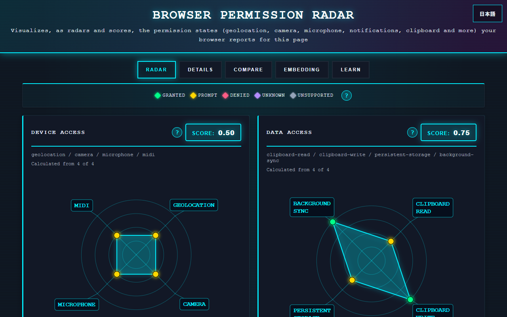
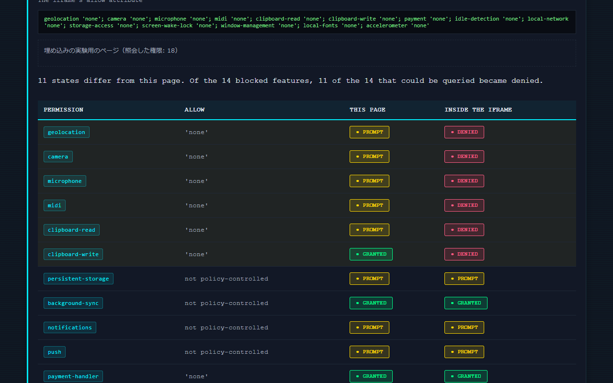

English · [日本語](README.md)

# Browser Permission Radar - Browser Permission Visualization Tool


[](https://ipusiron.github.io/browser-permission-radar/)

**Day092 - 100 Security Tools with Generative AI**

Browser Permission Radar visualizes the permission states your browser reports for this page (18 permissions, including geolocation, camera, microphone, notifications and clipboard) as four category radars with scores.

Safe permission tests and live updates that reflect every change on the spot let you experience permissions that the browser grants without asking and one-time permissions. You can also block permissions with an iframe's allow attribute (Permissions Policy) and compare your states with the defaults of a new browser profile or with results exported from another browser.

All queries and display happen inside the browser; no result is sent to any server. The interface is available in Japanese and English.

---

## 🌐 Demo

👉 **[https://ipusiron.github.io/browser-permission-radar/](https://ipusiron.github.io/browser-permission-radar/)**

Try it directly in your browser.

---

## 📸 Screenshots

>
>*Radar right after opening in Edge (some permissions are granted without asking)*

>
>*Embedding tab (features blocked with allow become denied inside the iframe)*

---

## ✨ Features

- Queries 18 permissions with `navigator.permissions.query()` and shows them as four radars with scores: device access; data access; communication and notifications; screen, network and sensors
- Never fills in a permission that could not be queried with a guess: it is `unknown` (cannot be queried) if the feature API exists, otherwise `unsupported` (not supported). `unknown` is excluded from the score average
- Also reads `Notification.permission` for notifications and treats its "not decided" value `default` as `prompt`. A mismatch with the Permissions API is noted in the Details tab
- Shows where each state comes from (Permissions API / Notification.permission / why it cannot be queried) in the Details tab
- Live updates: listens for `change` on each `PermissionStatus`; when you change a permission in the browser settings or from the lock icon in the address bar, the radar and log update immediately
- Safe permission tests (they run only when you press a button)
  - Notifications: `Notification.requestPermission()`
  - Geolocation: `getCurrentPosition()` (coordinates are not shown)
  - Camera / microphone: `getUserMedia()`, stopped immediately
  - Clipboard: `readText()` (contents are not shown) / `writeText('test')`
  - MIDI: `requestMIDIAccess()` (only the number of devices is shown)
  - Persistent storage: `navigator.storage.persist()`
  - Idle detection: `IdleDetector.requestPermission()`
  - Screen wake lock: `navigator.wakeLock.request('screen')` (released immediately)
  - Local fonts: `queryLocalFonts()` (only the count is shown)
  - Window management: `getScreenDetails()` (only the number of screens is shown)
  - Background Sync: only when pressed, registers a Service Worker (`sw.js`) that makes no network requests, then registers a sync. "Cleanup" unregisters it
- Compare tab: shows how many answers were obtained the moment the page opened without any user action, and a digest of the combination (first 16 hex digits of SHA-256). Compares with the defaults of a new profile (Edge and Firefox, measured) and lines up results exported as JSON from other browsers
- Embedding tab: puts this tool's query page in an iframe, blocks the features you choose with the `allow` attribute, queries there and lines up the results with this page (a Permissions Policy experiment)
- Pressing a point on a radar (or selecting it with Tab and pressing Enter) jumps to that permission's row in the Details tab. The score button filters the table by category
- The "?" buttons show an explanation and the risks of each permission (mouse, keyboard and touch)
- Learn tab: what a page can query, kinds of permissions and their risks, temporary permissions, permissions granted without asking, ClickFix (abuse of clipboard writes)
- Switch between Japanese and English (button at the top right, or `?lang=ja|en`)

---

## 📖 How to Use

### Basic use

1. Open the demo page. It queries 18 permissions right away and draws the radars and scores
2. Permissions that are `granted` right after opening are ones the browser allows without asking
3. Press the "Quick tests" buttons to experience the browser's permission prompts. Whether you allow or block, the radar and log update immediately
4. Revoke a permission from the lock icon in the address bar (site settings); the log shows "change reported by the browser" and the radar goes back
5. In the "Details" tab, check each permission's state, its source and the "?" explanation
6. When you are done, revoke this site's permissions in the browser settings and unregister the Service Worker with "Cleanup"

### Compare tab

1. "What a site can read without asking" shows how many answers were obtained the moment the page opened, and the digest of the combination
2. Choose a browser in "Default to compare with" to see which permissions differ from the state right after opening in a new profile (Edge and Firefox are selected automatically from the User-Agent)
3. Save your result with "Export as JSON"; load JSON files exported in another browser or on another PC to line them up in the table (up to 4)

### Embedding tab

1. Choose the features to allow in the iframe with the checkboxes (unchecked features are blocked with `'none'`)
2. Press "Embed with this allow and query"; the results of the query page (`probe.html`) inside the iframe are lined up with this page, and changed rows are highlighted

### Running locally

Serve the files over HTTPS (for example GitHub Pages) or from `http://localhost` / `http://127.0.0.1`. Because the tool uses ES modules, the page does not work in Chrome or Edge when opened from `file://`.

```bash
python -m http.server 8000
# open http://localhost:8000/
```

---

## 🧩 Categories and Scores

| Category | Permissions | Learning theme |
|---|---|---|
| 🟢 Device access | `geolocation`, `camera`, `microphone`, `midi` | Access to physical sensors and peripherals (covert filming, eavesdropping, locating you) |
| 🔵 Data access | `clipboard-read`, `clipboard-write`, `persistent-storage`, `background-sync` | Reading, writing, storing, and work after the page closes |
| 🟣 Communication & notifications | `notifications`, `push`, `payment-handler`, `idle-detection` | Luring through notifications, payments, monitoring presence |
| 🟠 Screen, network & sensors | `local-network`, `storage-access`, `screen-wake-lock`, `window-management`, `local-fonts`, `accelerometer` | LAN scanning, cross-site tracking, fingerprinting material |

The score of each category is the average score of the permissions that could be queried.

| State | Meaning | Score |
|---|---|---|
| granted | Allowed | 1.0 |
| prompt | Asks before use | 0.5 |
| denied | Blocked | 0.1 |
| unsupported | No feature API | 0.0 |
| unknown | The feature exists but this browser cannot query it | Excluded from the average |

Below each score, "Calculated from n of 4" shows how many permissions were used for the average. A higher score means this site is allowed more in that category.

---

## 🔭 What This Tool Can and Cannot See

- It sees only the states for the querying page's origin (`https://ipusiron.github.io`). Permissions given to other sites are invisible to every page
- The states it sees combine the browser's defaults (such as permissions granted without asking) with your decisions for this site
- Check other sites' permissions in the browser settings (Chrome: `chrome://settings/content`, Edge: `edge://settings/content`, Firefox: "Permissions" in `about:preferences#privacy`)
- These queries need no user action. Any site can run the same queries the moment it opens, and the results are also material for telling browsers apart

---

## 🎯 Use Cases

### Ways of using this tool in particular

- Compare the browsers' "defaults that do not ask": lining up the states right after opening in a new profile, Edge had three permissions `granted` from the start (`clipboard-write`, `background-sync` and `payment-handler`), giving a data access score of 0.75 and a communication & notifications score of 0.63. Firefox could not query `clipboard-read` or `clipboard-write` (`unknown`), so its data access score was 0.25, calculated from 2 of 4 (measured on 2026-10-10). The numbers show that, on the same page, how much a browser allows from the start depends on its design
- Count how much a site can read without asking: "What a site can read without asking" in the Compare tab counts the answers obtained the moment the page opened. Edge answered 18 of 18 and Firefox 9 of 18 (measured on 2026-10-10). Together with Day077's Browser Fingerprint Mirror, it shows that permission states themselves are fingerprinting material readable without any permission
- Measure the effect of Permissions Policy: when you choose "Block all" in the Embedding tab and query, Edge turned 11 of the 14 blocked features into `denied`, while `payment-handler`, `local-network` and `accelerometer` did not change. Firefox turned 4 of the 6 it could query into `denied`, while `midi` and `storage-access` did not change (measured on 2026-10-10). That some answers do not change even when "blocked" is worth checking when you design embedded web apps
- See how far newer permissions reach: the fourth radar (screen, network & sensors) could query 6 of 6 in Edge with a score of 0.75, while Firefox could not query many of them and scored 0.25 (measured on 2026-10-10). It gives an overview of recent permissions whose support varies by browser, such as connections to LAN devices (Local Network Access) and the font list
- Experience the premise of ClickFix: in Chromium-based browsers, pressing "Clipboard Write" overwrites the clipboard with `test` without any prompt. ClickFix, where a fake CAPTCHA silently writes a malicious command to the clipboard and tells the user to paste and run it, is built on this "write without asking". In training, pasting the overwritten clipboard into Notepad makes the point
- Time a one-time permission: in Chrome (desktop, 116 and later), choosing "Allow this time" for the camera turns the radar point `granted`. According to Chrome's official blog, it expires when the tab stays in the background for 5 minutes or more, when you navigate away, or after 16 hours, going back to `prompt`. If a `change` event arrives when it expires, the log records the time
- Measure the effect of embedding on another site: when you embed this tool in your own page with `<iframe>`, Edge turned all four device permissions `denied` without an `allow` attribute, giving a score of 0.10. With `allow="geolocation; camera; microphone; midi; clipboard-read; clipboard-write; idle-detection"` the score went back to 0.50 (measured on 2026-10-10). The page also tells you when it is embedded
- Check automated test environments: in Chromium's headless shell, the notification query said `prompt` while `Notification.permission` said `denied`, and the Details tab noted the mismatch. It helps you check whether the browser in your E2E tests runs with different permission states from real users' browsers
- Practice registering and cleaning up a Service Worker: register a Service Worker and a sync with "Background Sync", confirm the registration in the Application panel of the developer tools, then unregister it with "Cleanup". You experience something that keeps running after the page closes, all the way to removing it yourself

### Security learning and training

- Demonstrate "what happens when you allow notifications" and explain how fake warning notifications lure people to phishing sites
- Have each trainee open the tool in their own browser and export JSON, then load them all side by side (permissions `granted` from the start differ by browser and version)
- Revoke a permission from the lock icon and show the radar going back, to convey "permissions can be revoked" and "review them regularly" through experience
- Use it as material for CTFs or exercises: "Which permissions were stopped by Permissions Policy?" "Which permissions cannot be queried?"

### Work and development

- Web developers designing the permissions their site requests can check which permissions can and cannot be queried in each browser (the tool is static files under the MIT license, so placing it on a staging origin shows that origin's states)
- Before embedding an external widget, check how to write the `allow` attribute and its effect in the Embedding tab
- Support staff answering "notifications do not arrive" or "the camera does not work" can use it to explain how to tell apart the user's browser state (blocked, or stopped by embedding)
- Export JSON before and after a browser update and line them up to watch whether the defaults change

### Education and everyday life

- In IT classes, explain "permissions are recorded per site" and "permissions have a lifetime" through changes on the screen
- On a family PC, check together where in the browser settings to review permissions (this tool only sees its own site, so other sites' permissions are checked in the settings)
- Switch to the Japanese interface to learn Japanese security vocabulary

### Combining with other tools

- Combine with Day077's [Browser Fingerprint Mirror](https://github.com/ipusiron/browser-fingerprint-mirror) to learn the two layers: "information visible without permission" and "information that grows with permission" (see the section below)

---

## 🔬 Technical Notes

- Querying: each permission's descriptor is passed to `navigator.permissions.query()`. `push` is queried with `{ name: 'push', userVisibleOnly: true }` (Chrome rejects anything else). `local-network` is queried with the new name and, if rejected, again with the old name `local-network-access`
- Classification: if the query returns `granted`, `prompt` or `denied`, that value is used. If it is rejected with an exception (such as TypeError), the state is `unknown` when the feature API (such as `SyncManager` or `IdleDetector`) exists, otherwise `unsupported`. Only notifications are supplemented with `Notification.permission`, mapping `default` to `prompt`
- Live updates: a `change` listener is attached to each `PermissionStatus` obtained by the query; on a change, the tool queries again and logs the differences from the previous result. Queries never run concurrently; a request that arrives while one is running is executed once after it finishes
- Radar: drawn as SVG with `viewBox="0 0 400 400"`. Four axes are placed diagonally and label boxes are placed so they never cover the points. Points are `role="button"` elements selectable with click, Enter or Space
- Embedding experiment: the query page (`probe.html`) is placed in a same-origin iframe with an `allow` attribute that sets the blocked features to `'none'`. Results are sent with `postMessage` only to a same-origin parent, and the receiver checks the source iframe, the origin and the shape (a list of permission keys and states) before building the table
- Comparison: the combination is a string of "key=state" pairs in the order of the permission definitions, hashed with SHA-256 via `crypto.subtle`. The exported JSON contains only the tool name, version, date and time, name and the list of states. On import, the size (up to 64 KB), tool name, version, permission keys and states are validated, and control and direction-changing characters are removed from the name
- Japanese and English: fixed text uses `data-i18n`, Learn-tab text containing `<code>` uses `data-i18n-html` (only dictionary text is inserted), and tooltips and `aria-label` use `data-i18n-attr`. Log and status messages are kept as "key + parameters" and redrawn without querying again when the language changes
- Background Sync: `navigator.serviceWorker.ready` waits forever without a registration, so the tool registers `sw.js`, waits up to 5 seconds for it to become active and then calls `registration.sync.register()`. In browsers without `SyncManager` (Firefox and Safari) nothing is registered

See [TECHNICAL.md](TECHNICAL.md) and [PERMISSIONS_API.md](PERMISSIONS_API.md) for details (in Japanese).

---

## 🔒 Security and Privacy

- Nothing is sent: query results and logs stay inside the page and are never sent to a server. The CSP sets `connect-src 'none'`
- Nothing sensitive is shown: location coordinates, clipboard contents, font names and screen resolutions are never shown in the log even when obtained. The camera and microphone are stopped immediately
- Only on button presses: permission requests and Service Worker registration happen only when the user presses a button
- CSP (meta tag): `default-src 'self'`, `script-src 'self'`, `style-src 'self'` (no inline styles), `connect-src 'none'`, `worker-src 'self'`, `frame-src 'self'`, `object-src 'none'`, `base-uri 'self'`, `form-action 'none'`. No external libraries or CDNs
- Tables are built with the DOM and text is inserted with `textContent`. Only the fixed Learn-tab text written in the dictionary goes into `innerHTML`
- Messages between pages: embedding-experiment results are sent only to the same origin, and the receiver checks the sender and the shape. Imported JSON that does not have the expected shape is not added to the table
- Exported JSON is created inside the browser and only saved; it is never sent anywhere. It contains nothing but the optional name and the browser's states
- External links use `rel="noopener noreferrer"`, and the page uses `<meta name="referrer" content="no-referrer">`
- Embedding: the response headers that prevent clickjacking (`X-Frame-Options` and `frame-ancestors`) cannot be set on GitHub Pages and do not work in a meta tag. When embedded, the tool does not navigate the parent page (doing so with JavaScript throws in Chromium-based browsers and stops the page) and instead shows a notice that it is embedded

---

## ⚠️ Notes and Limitations

- It sees only the states for this site. It cannot audit the permissions of a device or of the whole browser
- The defaults in the Compare tab are the states right after opening in a new profile, measured on 2026-10-10 with Edge 155 and Firefox 146 on Windows. They may differ by version, OS and organization policy
- The Embedding tab experiment uses a same-origin iframe. When embedded in another site, some permissions, such as notifications and push, give different results
- Safari may answer `prompt` even when you have blocked a feature, until the page actually requests it, and its `change` events do not fire, so live updates do not work there (use the re-query after each test and "Rescan All")
- Whether a query returns `denied` when the browser-wide default is set to "block" may depend on the browser (not verified with this tool)
- Automated (headless) browsers may return different states from regular browsers
- "Clipboard Write" overwrites the clipboard with `test`
- In Firefox, "Persistent Storage" shows a prompt; the button stays "running" until you answer
- The wording of the file picker button (such as "Choose File") is decided by the browser and OS language and does not follow the page language

---

## 🔗 Learning Together with Browser Fingerprint Mirror

This tool visualizes what a browser can be asked for (the scope of permissions).
Its counterpart, [Browser Fingerprint Mirror](https://github.com/ipusiron/browser-fingerprint-mirror) made on Day077, reflects what a browser exposes automatically (its environment fingerprint).

| Aspect | Browser Permission Radar (Day092) | Browser Fingerprint Mirror (Day077) |
|---|---|---|
| Source of information | The user's permissions (active) | The browser environment itself (passive) |
| Nature of information | Access that grows with permission | Traits visible without asking |
| Who controls it | The user can allow, block and revoke | The user leaks it unknowingly |
| Educational theme | The weight of a permission | Unconscious exposure |

Note, however, that querying permission states itself needs no permission. As "What a site can read without asking" in the Compare tab shows, which permissions you allow or block is also part of the traits visible without asking.

### Example of combined learning

1. In Fingerprint Mirror, check the information visible without permission, such as the OS, screen, language and Canvas
2. In this tool's Compare tab, confirm that permission states can also be read without permission
3. Allow notifications, the camera and location, and watch the radar and the digest change
4. Put the two side by side and organize the layer visible without permission and the layer that grows with permission

---

## 🧪 Tests

```bash
npm test
```

- Runs on Node.js 22 or later with no dependencies (`node --test`)
- GitHub Actions runs it on every push and pull request
- Checks the classification of permissions (`unknown` versus `unsupported`, `default` → `prompt`), scores, querying (reproducing the 2026-10-10 measurements with a fake browser), radar geometry (labels never cover points), the embedding experiment (building `allow`, validating messages) and comparison (checking the default tables against the measurement records, export/import round trips, rejecting broken JSON)
- Also checks index.html (CSP, ARIA, button types, external links), color contrast in style.css (4.5:1 or higher), the Japanese and English dictionaries (same keys, same placeholders, no Japanese left in English, agreement with the default text in the HTML) and file formats
- The numbers in the README (use-case scores and counts) are recalculated from the measurement records and compared. The Japanese and English READMEs have the same number and order of headings

---

## 📁 Directory Structure

```
browser-permission-radar/
├── index.html                    # The page (five tabs, CSP)
├── script.js                     # UI logic (states, permission tests, live updates, comparison, embedding, languages)
├── style.css                     # Styles (dark theme, stacked layout on narrow screens)
├── sw.js                         # Service Worker registered only for the Background Sync test (no network)
├── probe.html                    # Query page placed in an iframe by the embedding experiment
├── js/                           # Modules loaded by the page
│   ├── perm-core.js              # Permission definitions, state classification, scores (no DOM)
│   ├── scanner.js                # Querying and classification (browser APIs passed in as arguments)
│   ├── radar-geom.js             # Radar coordinates and label placement
│   ├── radar-svg.js              # Draws the radar as SVG
│   ├── policy-core.js            # Embedding experiment (building allow, validating and comparing results)
│   ├── probe.js                  # Query page logic (sends results to a same-origin parent)
│   ├── compare-core.js           # What sites can read without asking, export/import, comparison with defaults
│   ├── messages.js               # UI and log text (Japanese and English)
│   └── i18n.js                   # Text lookup and language switching
├── test/                         # Automated tests (node --test)
│   ├── perm-core.test.js         # Classification and scores
│   ├── scanner.test.js           # Querying (fake browser)
│   ├── radar-geom.test.js        # Radar coordinates and label overlaps
│   ├── policy-core.test.js       # Embedding experiment logic
│   ├── compare-core.test.js      # Comparison logic (default tables checked against measurements)
│   ├── messages.test.js          # Text dictionary
│   ├── i18n.test.js              # Japanese/English dictionaries, default HTML text, initial language
│   ├── html.test.js              # Static checks of index.html
│   ├── contrast.test.js          # Color contrast
│   ├── format.test.js            # Line length, line endings, invisible characters
│   ├── readme.test.js            # README numbers and structure (Japanese and English)
│   └── fixtures/                 # Test data
│       └── measured-20261010.json # Query results measured on the public page and locally
├── assets/                       # README images
│   ├── screenshot.png            # Radar (Edge)
│   ├── screenshot2.png           # Details tab (Firefox)
│   ├── screenshot3.png           # Quick tests and log
│   ├── screenshot4.png           # Embedding tab
│   ├── screenshot5.png           # Compare tab
│   └── en/                       # English interface
│       ├── screenshot.png        # Radar (English)
│       └── screenshot2.png       # Embedding tab (English)
├── .github/                      # GitHub settings
│   └── workflows/                # GitHub Actions
│       └── test.yml              # Runs npm test on push and pull request
├── package.json                  # npm test definition (no dependencies)
├── README.md                     # README (Japanese)
├── README.en.md                  # This file
├── TECHNICAL.md                  # Implementation details (Japanese)
├── PERMISSIONS_API.md            # Permissions API specification and support (Japanese)
├── CLAUDE.md                     # Notes for Claude Code
├── AGENTS.md                     # Working guide for agents
├── LICENSE                       # MIT License
├── .gitignore                    # Git ignore rules
└── .nojekyll                     # Disables Jekyll on GitHub Pages
```

---

## 💻 Requirements

- Browser: latest Chrome, Edge or Firefox (ES modules and the Permissions API are required). Safari can query fewer permissions and live updates do not work there
- Open it over HTTPS or on `localhost` (many permissions work only in a secure context)
- The interface is in Japanese and English (button at the top right, or `?lang=ja` / `?lang=en`)

---

## 📄 License

MIT License – see [LICENSE](LICENSE) for details.

---

## 🛠️ About This Tool

This tool was developed as part of the "100 Security Tools with Generative AI" project.
The project creates and publishes a variety of security-related tools over 100 days with the help of AI.

For details of the project and other tools, see the page below (in Japanese).

🔗 [https://akademeia.info/?page_id=42163](https://akademeia.info/?page_id=42163)
