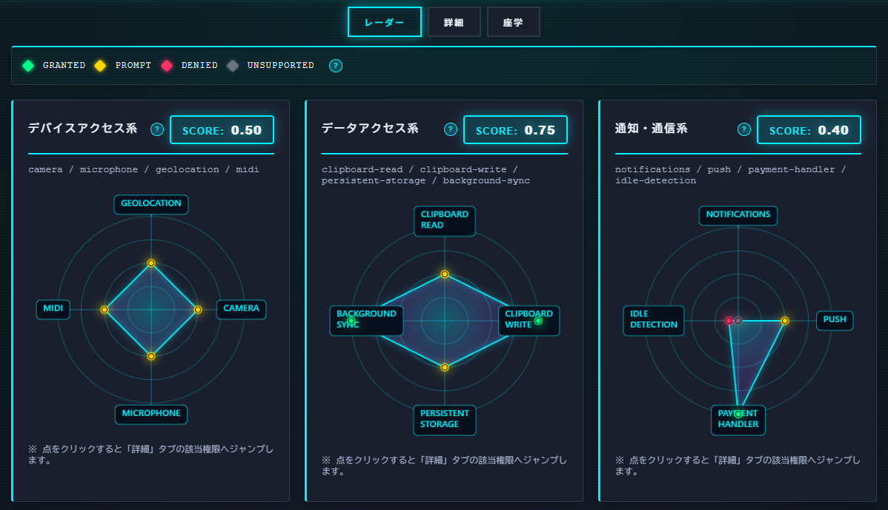

<!--
---
title: Browser Permission Radar
category: browser-security
difficulty: 2
description: Category-wise radar charts to visualize browser permission states with safe, on-page permission tests and score-linked details.
tags: [security, privacy, permissions, browser, education, javascript]
demo: https://ipusiron.github.io/browser-permission-radar/
---
-->

# Browser Permission Radar - ブラウザー権限可視化ツール


[](https://ipusiron.github.io/browser-permission-radar/)

**Day092 - 生成AIで作るセキュリティツール100**

**Browser Permission Radar** は、ブラウザーの主要権限（位置情報・カメラ・マイク・通知・クリップボードなど）を **カテゴリ別レーダーチャート＋スコア表示**でわかりやすく可視化するツールです。

安全な範囲で各種の **権限リクエストを体験** でき、ブラウザーがどのようにユーザー情報へアクセスするかを理解できます。

クライアントサイドのみで動作し、**データ送信は一切ありません**。

---

## 🌐 デモページ

👉 **[https://ipusiron.github.io/browser-permission-radar/](https://ipusiron.github.io/browser-permission-radar/)**

ブラウザーで直接お試しいただけます。

---

## 📸 スクリーンショット

>
>*ブラウザーに許可された権限を可視化する*

---

## ✨ 概要

- 各権限のステータス（`granted / denied / prompt / unsupported`）を即時スキャン
- **カテゴリ別レーダーチャート（3分割）**で構造的に表示
- 各カテゴリの平均スコアを表示し、**クリックで詳細テーブルにジャンプ**
- 各点（権限）をクリックすると、**該当行をハイライト**
- 各権限の安全な「テスト」ボタンを搭載
  - 通知: `Notification.requestPermission()`
  - 位置情報: `navigator.geolocation.getCurrentPosition()`（座標は非表示）
  - カメラ／マイク: `getUserMedia()` 即停止
  - クリップボード: `readText()` / `writeText('test')`（ユーザー操作必須、内容は非表示）
  - MIDIアクセス: `navigator.requestMIDIAccess()`
  - 永続ストレージ: `navigator.storage.persist()`
  - バックグラウンド同期: `registration.sync.register()`  

---

## 🎯 対象ユーザー

- セキュリティ教育に携わる講師・研修担当者
- CTF運営チームや問題作成者
- レッドチーム／ペネトレーションテスター
- ブラウザー権限設定を管理する企業のセキュリティ担当者

---

## 🧩 カテゴリ別レーダーチャート構成

本ツールでは、権限の性質に応じて3つのカテゴリに分け、それぞれに独立したレーダーチャートを表示します。  
これにより、「どの分野でどの程度ブラウザーに許可を与えているか」を一目で理解できます。

| カテゴリ | 権限 | 学習テーマ |
|-----------|--------|-------------|
| 🟢 **デバイスアクセス系** | `camera`, `microphone`, `geolocation`, `midi` | 物理的センサーや周辺機器へのアクセス（盗聴・盗撮・位置特定） |
| 🔵 **データアクセス系** | `clipboard-read`, `clipboard-write`, `persistent-storage`, `background-sync` | データ保存・転送・ローカル書き込みに関する権限 |
| 🟣 **通信・通知系** | `notifications`, `push`, `payment-handler`, `idle-detection` | 外部通信や心理的誘導リスクのある通知・決済・監視系統 |

各カテゴリには平均スコア（0〜1）が算出され、クリックすると「Details」タブでそのカテゴリのみをフィルター表示します。  
レーダー上の各点もクリックでき、該当権限行へ自動スクロール＆ハイライトします。

---

## 📊 スコアリングルール

| 状態 | スコア |
|------|---------|
| granted | 1.0 |
| prompt | 0.5 |
| denied | 0.1 |
| unsupported | 0.0 |

スコアが高いほど、そのカテゴリで許可されている権限が多いことを意味します。  
教育目的では「緑が広がるほどリスクが高まる」として視覚的に説明できます。

---

## 🔬 使い方

### ⚠️ 重要な前提条件

**このツールは必ず以下のいずれかの環境で実行してください：**

- **GitHub Pages等の公開サーバー**
- **ローカルサーバー（推奨）**: `http://localhost` または `http://127.0.0.1`
- **HTTPS環境**: `https://` で始まるURL

❌ **`file://` プロトコル（HTMLファイルを直接開く）では正しく動作しません**
→ 通知・位置情報などの権限が永続化されず、レーダーチャートの変化を観察できません。

#### ローカルサーバーの起動方法

```bash
# Python 3の場合
python -m http.server 8000

# Python 2の場合
python -m SimpleHTTPServer 8000

# Node.jsの場合
npx http-server -p 8000
```

起動後、ブラウザーで `http://localhost:8000` にアクセスしてください。

---

### 基本的な使い方

1. ページを開くと自動で権限をスキャン。
2. 各レーダーチャートでステータスとスコアを確認。
3. **点をクリック** → 「Details」タブへジャンプし該当権限をハイライト。
4. **Scoreボタンをクリック** → カテゴリ単位で絞り込み表示。
5. 「Quick Tests」エリアで安全な最小リクエストを実行。
6. 結果を確認したら「Rescan」で再スキャン。

---

## 🛡 活用シナリオ

### 1. CTF競技での権限分析課題

**概要**
ブラウザー権限の濫用をテーマにしたCTF問題で、参加者に権限設定を可視化させ、攻撃シナリオとの関連付けを促すことで、権限状態の読み解きとリスク評価のスキルを伸ばします。

**活用例**
- 「未許可→granted」の変化を体験し、権限エスカレーション経路を可視化
- マルチカテゴリの権限を組み合わせた攻撃チェーン（位置情報＋通知＝ストーキング）の理解促進
- フラグ取得条件「特定カテゴリのスコアを0.8以上にする」など、権限操作を伴うチャレンジ設計

---

### 2. レッドチーム演習／ペネトレーションテストの事前調査

**概要**
侵入テスト前の事前調査フェーズで、クライアント担当者に本ツールを操作してもらい、通知・位置情報・クリップボードなど敏感な権限の既定値を確認。許可済み権限を基にした攻撃チェーンをレポートに反映し、是正提案の優先順位付けに活用します。

**活用例**
- エンドユーザー端末の権限設定監査で、部署ごとのスコア分布を比較
- 社内ポリシー違反（全社禁止のはずの位置情報がgranted）を視覚的に検出
- レーダーチャートを報告書に添付し、非技術系経営層への説明資料として活用

---

### 3. セキュリティ研修での権限リスク体験学習

**概要**
企業や教育機関のセキュリティ研修で、「権限が与える影響範囲」を体験的に学習するツールとして活用。受講者が自身のブラウザーでカメラやマイクの許可を与える瞬間を体験し、レーダーチャートのスコア変化を観察することで、日常的なブラウザー利用のリスクを実感できます。

**活用例**
- 「通知を許可すると何が起こるか」を実際に体験し、フィッシングサイトへの誘導シナリオをデモ
- グループワークで各自の権限状態を共有し、「誰がもっともリスクを抱えているか」を比較
- 研修後のアンケートで「どの権限を見直したか」を集計し、行動変容の効果測定に利用
- マルウェア感染端末のレーダーを再現し、インシデント対応の予習に活用

---

### 4. Webアプリケーション開発チームの権限設計レビュー

**概要**
自社開発Webアプリケーションが要求する権限の妥当性を、開発者やプロダクトマネージャーがレビューする際の参考ツールとして活用。実装前に「このアプリはどの権限を要求すべきか」をRadarで可視化し、ユーザー体験とセキュリティのバランスを議論するための共通言語として機能します。

**活用例**
- 新機能リリース前に、要求する権限セットを可視化し、スコアが高すぎる場合は設計を見直し
- 競合サービスの権限要求状況をRadarで分析し、自社アプリの権限ポリシーとベンチマーク比較
- ユーザビリティテストで被験者が許可した権限の事後レビューをRadarで実施
- プライバシーポリシー策定時に、サービスの平均的な権限要求度合いをレーダーチャートで定量化し、法務・コンプライアンス部門との調整資料に利用

---

## 🔧 技術構成

### コア技術
- フロントエンドのみで完結（HTML + CSS + JavaScript）
- 外部ライブラリ・CDN不使用（完全自己ホスト）
- `navigator.permissions.query()` による権限状態取得
- 対応していないブラウザーでは自動的に `unsupported` フォールバック
- HTML5 Canvasを用いた独自レーダーチャート描画

### セキュリティ対策
- **CSP (Content Security Policy)**: `default-src 'self'` でサードパーティリソース読み込みを制限
- **XSS対策**: すべての動的コンテンツに対してHTMLエスケープ処理を実施
- **クリックジャッキング対策**: `X-Frame-Options: DENY` を設定
- **Tabnabbing対策**: 外部リンクに `rel="noopener noreferrer"` を設定
- **データ保護**: LocalStorage、SessionStorage、Cookie、サーバー通信は一切使用しない

📖 **関連ドキュメント**
- **[Permissions API 技術仕様書](PERMISSIONS_API.md)** - Permissions APIの詳細と技術解説
- **[技術実装ガイド](TECHNICAL.md)** - レーダーチャート描画、クリック判定、セキュリティ対策などの実装詳細

---

## 🔒 プライバシーと安全性

- **データ送信なし**: すべてローカルブラウザー内で処理。外部サーバーへの送信・保存は一切行いません。
- **機密情報の非表示**: 位置情報の座標、クリップボードの内容は取得してもログに表示しません。
- **即座に停止**: カメラ／マイク取得時は即座に `stop()` で停止。
- **ユーザー操作必須**: クリップボード・カメラ等は**ユーザー操作がない限りアクセス不可**。
- **セキュリティヘッダー**: CSP、X-Frame-Options、X-Content-Type-Options等を設定し、XSS・クリックジャッキング対策を実施。
- **HTMLエスケープ**: すべてのユーザー入力・動的コンテンツをエスケープ処理。

---

## 🎮 インタラクティブ機能

### スコアリンク＆フィルター
- **スコアリンク**: カテゴリの平均スコアをクリックすると、「Details」タブでそのカテゴリのみを表示
- **カテゴリフィルター**: Detailsタブ上部のチップ（All / Device / Data / Comm）で切り替え可能

### レーダーチャート操作
- **点クリック**: レーダー上の点をクリック（または点の周辺30px以内）すると、自動的に「Details」タブへ切り替わり、該当権限の行にスクロール＆ハイライト
- **視認性向上**: レーダーチャートの点は、ラベルより手前に描画されるため、MAX値（granted）でも視認可能

### ツールチップ
- **詳細なリスク解説**: 各権限の「?」アイコンにマウスオーバーまたはフォーカスすると、権限の説明とセキュリティリスクを表示
- **スマート配置**: ツールチップは画面端で自動的に位置調整され、常に読みやすい位置に表示

この構成により、単なる可視化ではなく、**"探索的学習"** ができる設計になっています。
「どの権限を与えているか」だけでなく、「どの分野に偏っているか」も見えるようになります。

---

## 🔗 Browser Fingerprint Mirrorとの学習効果

本ツールのBrowser Permission Radarは、**ブラウザーが「何を要求できるか」**（＝権限の範囲）を可視化します。
対になる、Day077で作成した[Browser Fingerprint Mirror](https://github.com/ipusiron/browser-fingerprint-mirror)は、**ブラウザーが「何を自動的に晒しているか」**（＝環境指紋）を映し出します。

この2つを対比させることで、ブラウザー識別の**二層構造**を学べます。

| 観点 | Permission Radar（Day092） | Fingerprint Mirror（Day077） |
|------|------------------------------|-------------------------------|
| 情報の発生源 | **ユーザーの許可行動**（能動的） | **ブラウザー環境そのもの**（受動的） |
| 情報の性質 | 明示的に許可された動的データ | 自動的に送信される静的メタ情報 |
| コントロールの主体 | ユーザーが許可・拒否を選べる | ユーザーが意識せず漏らす |
| 教育的テーマ | 「許可の重み」 | 「無意識の露出」 |

### 🧭 対比の本質

- **Browser Fingerprint Mirror** は「受動的な露出（passive exposure）」の世界。  
  許可を与えなくても、環境変数や描画特性から識別されうる。  
- **Browser Permission Radar** は「能動的な許可（active consent）」の世界。  
  明示的な許可によって、ブラウザーはより深い情報へアクセスできる。

両者を組み合わせると、  
> **受動的情報（Fingerprint）＋能動的許可（Permissions）＝ブラウザー識別の全体像**

という構造が浮かび上がります。  
前者が「露出の基礎層」、後者が「アクセス権の拡張層」。  
この二層を体験的に学ぶことで、プライバシーリスクの理解が格段に深まります。

### 🧩 組み合わせ学習シナリオ例

1. **Step 1：Fingerprintsの観察**  
   → OS、解像度、言語、Canvas指紋など「許可なしで見える情報」を確認。  
2. **Step 2：Permissionsの体験**  
   → 通知・カメラ・位置情報を許可し、動作を観察。  
3. **Step 3：結果を比較**  
   → 無許可情報と許可情報の違いを整理し、「露出と許可の層構造」を可視化。  

この2ツールをペアで使うと、**ブラウザーがどのように"あなた"を特定しているのか**を立体的に学ぶことができます。

---

## 💡 教育利用のヒント

- 授業やワークショップでは「Permission Radar → Fingerprint Mirror」の順で実演すると効果的。  
- 参加者ごとにPermission状態を比べて、「誰のブラウザーが一番"オープン"か」を視覚的に比較できる。
- セキュリティ教育だけでなく、プライバシーUX設計やユーザビリティ研究にも応用可。

---

## 📁 ディレクトリー構成

```
browser-permission-radar/
├── index.html              # メインHTMLファイル
├── script.js               # コアロジック（権限スキャン、レーダー描画、クリック判定）
├── style.css               # サイバーパンク風スタイル
├── assets/
│   └── screenshot.png      # スクリーンショット画像
├── README.md               # プロジェクト概要（このファイル）
├── TECHNICAL.md            # 技術実装ガイド（開発者向け）
├── PERMISSIONS_API.md      # Permissions API技術仕様書
├── CLAUDE.md               # Claude Code向けプロジェクト情報
├── AGENTS.md               # エージェント向けガイド
└── LICENSE                 # MITライセンス
```

### ファイル説明

| ファイル | 説明 | 行数 |
|---------|------|------|
| `index.html` | アプリケーションのUI構造。3タブ構成（レーダー、詳細、座学） | ~270行 |
| `script.js` | 権限スキャン、レーダーチャート描画、クリック判定、アコーディオン機能 | ~755行 |
| `style.css` | サイバーパンク風デザイン、レスポンシブ対応、アニメーション | ~600行 |
| `TECHNICAL.md` | レーダー描画アルゴリズム、クリック判定、セキュリティ実装の詳細解説 | - |
| `PERMISSIONS_API.md` | Permissions APIの仕様、ブラウザー互換性、実装パターン | - |

---

## 📄 ライセンス

MIT License – 詳細は [LICENSE](LICENSE) を参照してください。

---

## ℹ️ このツールについて

本ツールは、「生成AIで作るセキュリティツール100」プロジェクトの一環として開発されました。
このプロジェクトでは、AIの支援を活用しながら、セキュリティに関連するさまざまなツールを100日間にわたり制作・公開していく取り組みを行っています。

プロジェクトの詳細や他のツールについては、以下のページをご覧ください。

🔗 [https://akademeia.info/?page_id=42163](https://akademeia.info/?page_id=42163)
