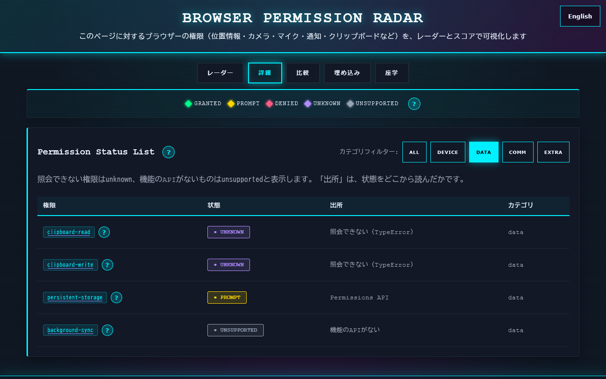
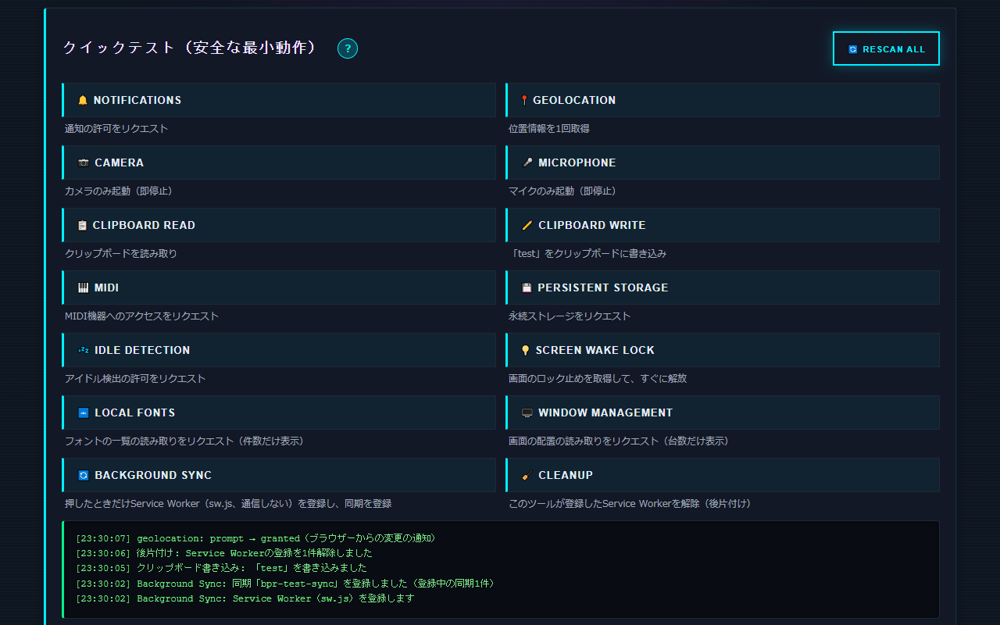
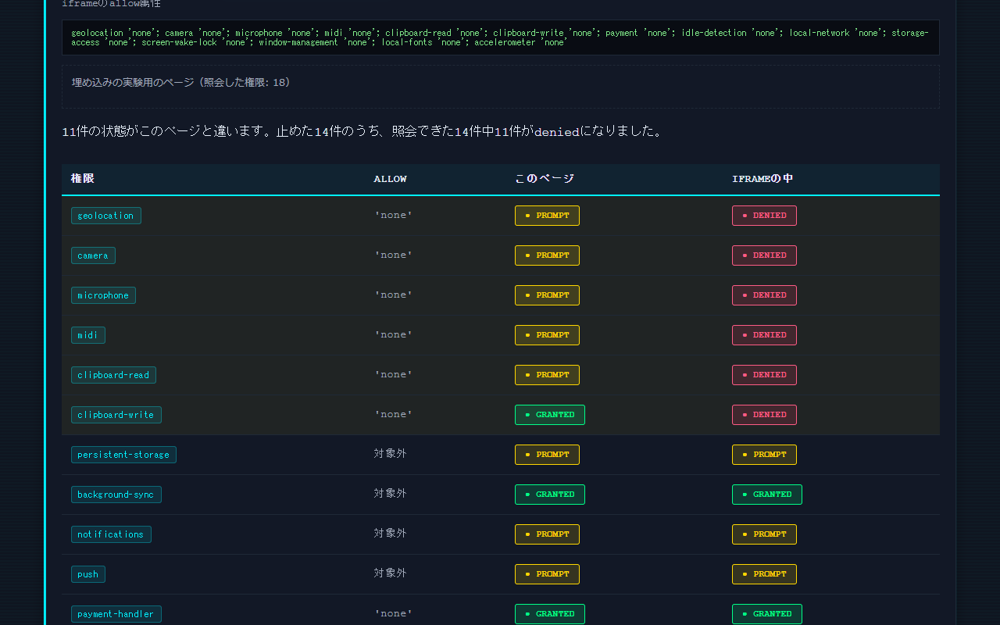
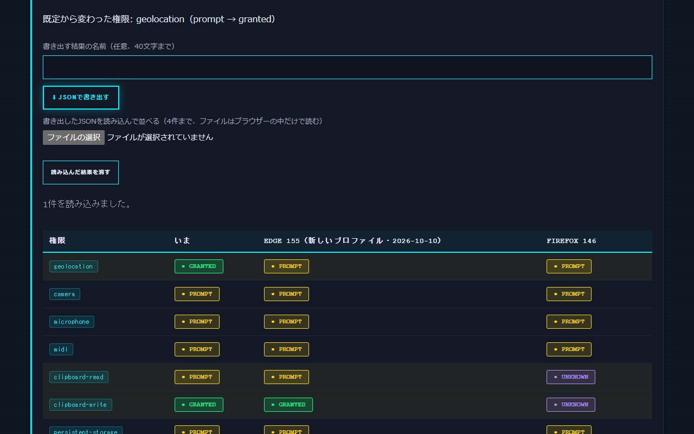

<!--
---
id: day092
slug: browser-permission-radar

title: "Browser Permission Radar"

subtitle_ja: "ブラウザー権限可視化ツール"
subtitle_en: "Browser Permission Visualization Tool"

description_ja: "このページに対するブラウザーの権限の状態（位置情報・カメラ・マイク・通知・クリップボードなど18種）をカテゴリ別のレーダーとスコアで可視化し、安全な権限テスト・変化のライブ表示・Permissions Policyの実験・既定との比較で、尋ねずに許可される権限や尋ねずに読める情報を体験できる教育ツール"
description_en: "Visualizes the permission states this page sees (18 permissions such as geolocation, camera, microphone, notifications, clipboard) as category radars and scores, with safe permission tests, live updates, a Permissions Policy experiment, and comparisons with browser defaults that reveal auto-granted permissions and what sites can read without asking"

category_ja:
  - ブラウザーセキュリティ
  - プライバシー
  - Webセキュリティ
category_en:
  - Browser Security
  - Privacy
  - Web Security

difficulty: 3

tags:
  - security
  - privacy
  - permissions
  - browser
  - education
  - javascript
  - radar-chart
  - visualization
  - permissions-policy
  - fingerprinting

repo_url: "https://github.com/ipusiron/browser-permission-radar"
demo_url: "https://ipusiron.github.io/browser-permission-radar/"

hub: true
---
-->

# Browser Permission Radar - ブラウザー権限可視化ツール

[English](README.en.md) · 日本語


[](https://ipusiron.github.io/browser-permission-radar/)

**Day092 - 生成AIで作るセキュリティツール100**

Browser Permission Radarは、このページに対するブラウザーの権限の状態（位置情報・カメラ・マイク・通知・クリップボードなど18種）を、カテゴリ別の4つのレーダーとスコアで可視化するツールです。

安全な範囲で権限を要求するテストと、許可の変化をその場で映すライブ表示で、ブラウザーが「尋ねずに許可している権限」や「今回のみの許可」を体験できます。iframeのallow属性で権限を止める実験（Permissions Policy）と、新しいプロファイルの既定や別のブラウザーの結果との比較もできます。

照会と表示はブラウザーの中だけで行い、結果をサーバーへ送りません。画面は日本語と英語に対応しています。

---

## 🌐 デモページ

👉 **[https://ipusiron.github.io/browser-permission-radar/](https://ipusiron.github.io/browser-permission-radar/)**

ブラウザーで直接お試しいただけます。

---

## 📸 スクリーンショット

>
>*Edgeで開いた直後のレーダー（尋ねられずにgrantedの権限がある）*

>
>*Firefoxの詳細タブ（照会できない権限はunknown、出所も表示）*

>
>*クイックテストとログ（同期の登録・後片付け・変更の通知）*

>
>*埋め込みタブ（allowで止めた機能がiframeの中でdeniedになる）*

>
>*比較タブ（既定から変わった権限と、別のブラウザーの結果）*

---

## ✨ 機能

- 18種の権限を`navigator.permissions.query()`で照会し、デバイス・データ・通信と通知・画面とネットワークとセンサーの4つのレーダーとスコアで表示する
- 照会できなかった権限を推測で埋めない。機能のAPIがあれば`unknown`（照会できない）、なければ`unsupported`（機能なし）と分け、`unknown`はスコアの平均に入れない
- 通知は`Notification.permission`も読み、未決定の`default`を`prompt`として扱う。Permissions APIと食い違えば詳細タブに注記する
- 状態の出所（Permissions API／Notification.permission／照会できない理由）を詳細タブに出す
- ライブ更新: `PermissionStatus`の`change`を受け取り、ブラウザーの設定やアドレスバーの鍵のアイコンで許可を変えると、その場でレーダーとログに反映する
- 安全な権限テスト（ボタンを押したときだけ動く）
  - 通知: `Notification.requestPermission()`
  - 位置情報: `getCurrentPosition()`（座標は表示しない）
  - カメラ／マイク: `getUserMedia()`で起動してすぐ止める
  - クリップボード: `readText()`（内容は表示しない）／`writeText('test')`
  - MIDI: `requestMIDIAccess()`（機器の数だけ表示）
  - 永続ストレージ: `navigator.storage.persist()`
  - アイドル検出: `IdleDetector.requestPermission()`
  - 画面のロック止め: `navigator.wakeLock.request('screen')`（取得してすぐ解放）
  - ローカルフォント: `queryLocalFonts()`（件数だけ表示）
  - 画面の配置: `getScreenDetails()`（画面の台数だけ表示）
  - Background Sync: 押したときだけ通信しないService Worker（`sw.js`）を登録して同期を登録する。「Cleanup」で登録を解除する
- 比較タブ: 開いた瞬間に利用者の操作なしで得られた答えの数と、組み合わせの要約値（SHA-256の先頭16桁）を出す。新しいプロファイルの既定（Edge・Firefox、実測）と比べ、結果をJSONで書き出して別のブラウザーの結果と並べる
- 埋め込みタブ: このツールの照会用のページをiframeに入れ、選んだ機能を`allow`属性で止めて照会し、このページの結果と並べる（Permissions Policyの実験）
- レーダーの点を押す（またはTabキーで選んでEnter）と、詳細タブのその権限の行へ移る。スコアのボタンでカテゴリに絞り込む
- 「?」のボタンで各権限の説明とリスクを表示する（マウス・キーボード・タップ）
- 座学タブ: 照会できる範囲、権限の種類とリスク、一時的な許可、尋ねられない権限、ClickFix（クリップボードへの書き込みの悪用）
- 日本語と英語の切り替え（右上のボタン、`?lang=ja|en`）

---

## 📖 使い方

### 基本的な使い方

1. デモページを開きます。開いた直後に18種の権限を照会し、レーダーとスコアを描きます
2. 開いた直後から`granted`の権限は、ブラウザーが尋ねずに許可しているものです
3. 「クイックテスト」のボタンを押し、ブラウザーの問い合わせを体験します。許可・拒否の結果は、レーダーとログにすぐ反映されます
4. アドレスバーの鍵のアイコン（サイトの設定）から許可を取り消すと、ログに「ブラウザーからの変更の通知」が出て、レーダーが戻ります
5. 「詳細」タブで、各権限の状態と出所、「?」の説明を確かめます
6. 試し終えたら、ブラウザーの設定でこのサイトの許可を取り消し、「Cleanup」でService Workerの登録を解除します

### 比較タブ

1. 「サイトが尋ねずに読める情報」で、開いた瞬間に得られた答えの数と、組み合わせの要約値を確かめます
2. 「比べる既定」でブラウザーを選ぶと、新しいプロファイルで開いた直後の状態から変わった権限が出ます（Edge・Firefoxは、User-Agentから自動で選びます）
3. 「JSONで書き出す」で結果を保存し、別のブラウザーや別のPCで書き出したJSONを読み込むと、表に並びます（4件まで）

### 埋め込みタブ

1. iframeに許す機能をチェックで選びます（チェックを外した機能は`'none'`で止めます）
2. 「このallowで埋め込んで照会」を押すと、iframeの中の照会用のページ（`probe.html`）の結果がこのページの結果と並び、変わった行が色で示されます

### ローカルで動かす

HTTPS（GitHub Pagesなど）か、`http://localhost`・`http://127.0.0.1`で配信してください。ES modulesを使うため、`file://`で開くとChrome・Edgeでは画面が動きません。

```bash
python -m http.server 8000
# http://localhost:8000/ を開く
```

---

## 🧩 カテゴリとスコア

| カテゴリ | 権限 | 学習テーマ |
|---|---|---|
| 🟢 デバイスアクセス系 | `geolocation`, `camera`, `microphone`, `midi` | 物理的なセンサーや周辺機器へのアクセス（盗撮・盗聴・位置の特定） |
| 🔵 データアクセス系 | `clipboard-read`, `clipboard-write`, `persistent-storage`, `background-sync` | 読み書き・保存・閉じたあとの処理 |
| 🟣 通信・通知系 | `notifications`, `push`, `payment-handler`, `idle-detection` | 通知での誘導・決済・在席の監視 |
| 🟠 画面・ネットワーク・センサー系 | `local-network`, `storage-access`, `screen-wake-lock`, `window-management`, `local-fonts`, `accelerometer` | LANの探索・サイトをまたいだ追跡・ブラウザーを見分ける材料 |

各カテゴリのスコアは、照会できた権限のスコアの平均です。

| 状態 | 意味 | スコア |
|---|---|---|
| granted | 許可済み | 1.0 |
| prompt | 使う前に尋ねられる | 0.5 |
| denied | 拒否済み | 0.1 |
| unsupported | 機能のAPIがない | 0.0 |
| unknown | 機能はあるが、このブラウザーでは照会できない | 平均に入れない |

スコアの下に「4件中n件で計算」と、平均に使えた件数を出します。スコアが高いほど、そのカテゴリでこのサイトに許していることが多い、という目安です。

---

## 🔭 このツールに見えるもの・見えないもの

- 見えるのは、照会したページのオリジン（`https://ipusiron.github.io`）に対する状態だけです。ほかのサイトに与えた許可は、どのページからも見えません
- 見えている状態は、ブラウザーの既定（尋ねずに許可する権限など）と、このサイトへの決定を重ねたものです
- ほかのサイトの許可は、ブラウザーの設定で確かめます（Chromeは`chrome://settings/content`、Edgeは`edge://settings/content`、Firefoxは`about:preferences#privacy`の「許可設定」）
- この照会には、利用者の操作が要りません。どのサイトも開いた瞬間に同じ照会ができ、その結果はブラウザーを見分ける材料にもなります

---

## 🎯 ユースケース

### このツールならではの使い方

- ブラウザーの「尋ねない既定」を比べる: 新しいプロファイルで開いた直後の状態を並べると、Edgeは`clipboard-write`・`background-sync`・`payment-handler`の3つが最初から`granted`で、データ系のスコアは0.75、通信・通知系は0.63でした。Firefoxは`clipboard-read`・`clipboard-write`を照会できず（`unknown`）、データ系は4件中2件で計算して0.25でした（2026-10-10の実測）。同じページでも、ブラウザーの設計によって「最初から許している範囲」が違うことを数字で示せます
- サイトが尋ねずに読める量を数える: 比較タブの「尋ねずに読める情報」は、開いた瞬間に得られた答えの数を出します。Edgeでは18件中18件、Firefoxでは18件中9件でした（2026-10-10の実測）。権限の状態そのものが、許可なしで読める指紋の材料になることを、Day077のBrowser Fingerprint Mirrorと並べて説明できます
- Permissions Policyの効き目を測る: 埋め込みタブで「すべて止める」にして照会すると、Edgeでは止めた14件のうち11件が`denied`になり、`payment-handler`・`local-network`・`accelerometer`は答えが変わりませんでした。Firefoxでは照会できた6件中4件が`denied`になり、`midi`・`storage-access`は変わりませんでした（2026-10-10の実測）。「止めたつもりでも照会の答えが変わらない権限がある」ことは、Webアプリの埋め込みを設計するときの確認項目になります
- 新しい権限の広がりを見る: 4つ目のレーダー（画面・ネットワーク・センサー系）は、Edgeでは6件中6件を照会できてスコアは0.75、Firefoxは照会できない権限が多く0.25でした（2026-10-10の実測）。LANの機器への通信（Local Network Access）やフォントの一覧など、ブラウザーごとに対応が分かれる最近の権限を一望できます
- ClickFixの前提を体験する: Chromium系で「Clipboard Write」を押すと、問い合わせは出ずにクリップボードが`test`に書き換わります。偽のCAPTCHAが裏でクリップボードに悪性のコマンドを書き込み、貼り付けて実行させるClickFixは、この「尋ねられない書き込み」を土台にしています。研修では、書き換わったクリップボードをメモ帳に貼って見せると伝わります
- 「今回のみ許可」の寿命を計る: Chrome（116以降のデスクトップ版）でカメラの問い合わせに「今回のみ許可」を選ぶと、レーダーの点が`granted`になります。Chromeの公式ブログでは、タブを5分以上裏に置く・別のページへ移る・16時間たつなどで失効し、`prompt`に戻るとされています。失効したときに`change`が届けば、ログにその時刻が残ります
- 埋め込み（iframe）の影響を別のサイトで測る: 自分のページにこのツールを`<iframe>`で埋め込むと、Edgeでは`allow`属性なしでデバイス系が4つとも`denied`になり、スコアは0.10でした。`allow="geolocation; camera; microphone; midi; clipboard-read; clipboard-write; idle-detection"`を付けると0.50に戻りました（2026-10-10の実測）。埋め込まれたことは画面の案内でもわかります
- 自動テストの環境を点検する: Chromiumのheadless shellでは、通知の照会が`prompt`なのに`Notification.permission`は`denied`と食い違い、詳細タブに注記が出ました。E2Eテストのブラウザーが、実際の利用者のブラウザーと違う権限の状態で動いていないかを確かめる手がかりになります
- Service Workerの登録と後片付けを練習する: 「Background Sync」でService Workerと同期を登録し、開発者ツールのApplication（アプリケーション）パネルで登録を確かめてから、「Cleanup」で解除します。閉じたあとも動く仕組みを、自分で消せるところまで体験できます

### セキュリティの学習・研修

- 研修で「通知を許可すると何が起こるか」を実演し、偽の警告の通知でフィッシングサイトへ誘導する手口を説明する
- 受講者がそれぞれのブラウザーで開いてJSONを書き出し、講師が読み込んで並べる（ブラウザーと版で、最初から`granted`の権限が違う）
- 鍵のアイコンから許可を取り消し、レーダーが戻ることを見せて、「許可は取り消せる」「定期的に見直す」を体験的に伝える
- CTFや演習の題材として、「Permissions Policyで止められた権限はどれか」「照会できない権限はどれか」を問う

### 仕事・開発

- Web開発者が、自社のサイトで要求する権限を設計するとき、ブラウザーごとに照会できる権限・できない権限を確かめる（このツールはMITライセンスの静的ファイルなので、ステージング環境のオリジンに置けば、そのオリジンの状態を見られる）
- 外部のウィジェットを埋め込む前に、埋め込みタブで`allow`属性の書き方と効き目を確かめる
- サポート担当が、「通知が届かない」「カメラが使えない」という問い合わせで、利用者のブラウザーの状態（拒否済みか、埋め込みで止められているか）を切り分ける説明に使う
- ブラウザーの更新の前後でJSONを書き出して並べ、既定が変わったかを定点観測する

### 教育・暮らし

- 情報の授業で、「サイトごとに許可が記録される」「許可にはいつまで続くかがある」を、画面の変化で説明する
- 家族のパソコンで、ブラウザーの設定のどこで許可を見直すかを一緒に確かめる（このツールは自分のサイトの状態しか見えないので、ほかのサイトの許可は設定画面で見る）
- 英語の画面に切り替えて、英語の授業やセキュリティの英語の用語の学習に使う

### 他のツールとの組み合わせ

- Day077の[Browser Fingerprint Mirror](https://github.com/ipusiron/browser-fingerprint-mirror)と組み合わせ、「許可しなくても見える情報」と「許可で広がる情報」の二層を学ぶ（下の節）

---

## 🔬 技術的な説明

- 照会: `navigator.permissions.query()`に権限ごとの記述子を渡します。`push`は`{ name: 'push', userVisibleOnly: true }`で照会します（Chromeはこれ以外を拒否します）。`local-network`は新しい名前で照会し、受け付けられなければ旧名`local-network-access`で照会し直します
- 分類: 照会が`granted`・`prompt`・`denied`を返せばそのまま使います。例外（TypeErrorなど）で拒否されたら、機能のAPI（`SyncManager`・`IdleDetector`など）があれば`unknown`、なければ`unsupported`にします。通知だけは`Notification.permission`で補い、`default`を`prompt`に直します
- ライブ更新: 照会で得た`PermissionStatus`に`change`のリスナーを付け、変化があれば照会し直して、前回との差分をログに出します。照会し直しは同時に走らせず、走っている間に来た要求は終わったあとに1回だけ実行します
- レーダー: `viewBox="0 0 400 400"`のSVGで描きます。4軸は斜めに置き、ラベルの箱は点にかからない位置に出します。点は`role="button"`の要素で、クリック・Enter・Spaceで選べます
- 埋め込みの実験: 照会用のページ（`probe.html`）を同じオリジンのiframeに入れ、止める機能を`'none'`にした`allow`属性を付けます。結果は`postMessage`で同じオリジンの親にだけ送り、受け手は送り元のiframe・オリジン・形（権限キーと状態の一覧）を確かめてから表にします
- 比較: 組み合わせは権限の定義の順に「キー=状態」をつないだ文字列にし、`crypto.subtle`でSHA-256を計算します。書き出すJSONはツール名・版・日時・名前・状態の一覧だけで、読み込むときは大きさ（64KBまで）・ツール名・版・権限キー・状態を検証し、名前から制御文字と向きを変える文字を除きます
- 日英: 画面の固定の文は`data-i18n`、`<code>`を含む座学の文は`data-i18n-html`（辞書の文だけを入れる）、ツールチップや`aria-label`は`data-i18n-attr`で切り替えます。ログ・状態の文は「キー＋引数」で持ち、言語を変えたら照会し直さずに描き直します
- Background Sync: `navigator.serviceWorker.ready`は登録がないと永遠に待つので、`register('sw.js')`で登録し、有効になるのを5秒まで待ってから`registration.sync.register()`を呼びます。`SyncManager`のないブラウザー（Firefox・Safari）では登録しません

詳しくは[TECHNICAL.md](TECHNICAL.md)と[PERMISSIONS_API.md](PERMISSIONS_API.md)を参照してください。

---

## 🔒 セキュリティとプライバシー

- 送信しない: 照会の結果・ログはページの中だけにあり、サーバーへ送りません。CSPで`connect-src 'none'`にしています
- 見せない: 位置情報の座標・クリップボードの内容・フォントの名前・画面の解像度は、取得してもログに表示しません。カメラ・マイクは取得してすぐ止めます
- ボタンを押したときだけ: 権限の要求とService Workerの登録は、利用者がボタンを押したときだけ行います
- CSP（metaタグ）: `default-src 'self'`、`script-src 'self'`、`style-src 'self'`（インラインのスタイルを許さない）、`connect-src 'none'`、`worker-src 'self'`、`frame-src 'self'`、`object-src 'none'`、`base-uri 'self'`、`form-action 'none'`。外部のライブラリー・CDNは使いません
- 表の描画はDOMで組み立て、文字は`textContent`で入れます。`innerHTML`に入れるのは、辞書に書いた座学の固定の文だけです
- ページ間のメッセージ: 埋め込みの実験の結果は同じオリジンにだけ送り、受け手は送り元と形を確かめます。読み込むJSONも、形が違えば表に入れません
- 書き出すJSONはブラウザーの中で作って保存するだけで、どこにも送りません。名前（任意）とブラウザーの状態のほかは含みません
- 外部リンクは`rel="noopener noreferrer"`、`<meta name="referrer" content="no-referrer">`
- 埋め込み: クリックジャッキングを防ぐレスポンスヘッダー（`X-Frame-Options`や`frame-ancestors`）は、GitHub Pagesでは設定できず、metaタグでは効きません。このツールは埋め込まれても親のページを移動させず（JavaScriptで移動させる方法はChromium系では例外になり、画面が止まるため）、埋め込まれていることを案内します

---

## ⚠️ 注意と限界

- 見えるのはこのサイトに対する状態だけです。端末やブラウザー全体の権限の監査には使えません
- 比較タブの既定は、2026-10-10にWindowsのEdge 155・Firefox 146で、新しいプロファイルで開いた直後に測った状態です。版やOS、組織のポリシーで変わることがあります
- 埋め込みタブの実験は、同じオリジンのiframeでの結果です。別のサイトに埋め込まれた場合は、通知・pushのように結果が変わる権限があります
- Safariは、拒否していても実際に要求するまで`prompt`と答えることがあり、`change`の通知も届かないので、ライブ更新が効きません（テストのあとの照会し直しと「Rescan All」で追ってください）
- ブラウザー全体の既定を「ブロック」にしたときに照会が`denied`を返すかは、ブラウザーによって違う可能性があります（このツールでは確かめていません）
- 自動操作のブラウザー（headless）は、通常のブラウザーと違う状態を返すことがあります
- 「Clipboard Write」はクリップボードの中身を`test`で上書きします
- Firefoxで「Persistent Storage」を押すと問い合わせが出ます。答えるまでボタンは「実行中」のままです
- ファイルを選ぶボタンの文言（「ファイルの選択」など）は、ブラウザーとOSの言語で決まり、画面の言語では切り替わりません

---

## 🔗 Browser Fingerprint Mirrorとの学習効果

本ツールは、ブラウザーが「何を要求できるか」（権限の範囲）を可視化します。
対になる、Day077で作成した[Browser Fingerprint Mirror](https://github.com/ipusiron/browser-fingerprint-mirror)は、ブラウザーが「何を自動的に晒しているか」（環境の指紋）を映し出します。

| 観点 | Browser Permission Radar（Day092） | Browser Fingerprint Mirror（Day077） |
|---|---|---|
| 情報の発生源 | 利用者の許可（能動的） | ブラウザーの環境そのもの（受動的） |
| 情報の性質 | 許可によって広がるアクセス | 尋ねられずに見える特徴 |
| コントロールの主体 | 利用者が許可・拒否・取り消しを選べる | 利用者が意識せずに漏らす |
| 教育的テーマ | 許可の重み | 無意識の露出 |

ただし、権限の状態を照会すること自体は許可が要りません。比較タブの「尋ねずに読める情報」のとおり、「どの権限を許可・拒否しているか」も、尋ねられずに見える特徴の一部です。

### 組み合わせ学習の例

1. Fingerprint Mirrorで、OS・画面・言語・Canvasなど「許可なしで見える情報」を確かめる
2. 本ツールの比較タブで、権限の状態も許可なしで読めることを確かめる
3. 通知・カメラ・位置情報を許可し、レーダーと要約値の変化を見る
4. 2つを並べ、「許可なしで見える層」と「許可で広がる層」を整理する

---

## 🧪 テスト

```bash
npm test
```

- Node.js 22以上で動きます。依存パッケージはありません（`node --test`）
- GitHub Actionsでpushとpull requestのたびに自動で実行します
- 権限の分類（`unknown`と`unsupported`の区別、`default`→`prompt`）、スコア、照会（偽のブラウザーで2026-10-10の実測を再現）、レーダーの座標（ラベルが点に重ならない）、埋め込みの実験（`allow`の組み立て・メッセージの検証）、比較（既定の表を実測の記録で検算・書き出しと読み込みの往復・壊れたJSONの拒否）を検査します
- index.html（CSP・ARIA・ボタンの種類・外部リンク）、style.cssの配色のコントラスト（4.5:1以上）、日英の辞書（同じキー・同じ差し込み・英語に日本語が残らない・HTMLの既定の文との一致）、ファイルの形式も検査します
- READMEの数値（ユースケースのスコアと件数）も、実測の記録から計算し直して照らし合わせます。英語版のREADMEとは見出しの数と並びをそろえます

---

## 📁 ディレクトリー構造

```
browser-permission-radar/
├── index.html                    # 画面（5つのタブ・CSP）
├── script.js                     # 画面の処理（照会の表示・権限テスト・ライブ更新・比較・埋め込み・日英）
├── style.css                     # スタイル（ダークテーマ・狭い画面の縦積み）
├── sw.js                         # Background Syncを試すときだけ登録するService Worker（通信しない）
├── probe.html                    # 埋め込みの実験でiframeに入れる照会用のページ
├── js/                           # 画面から読むモジュール
│   ├── perm-core.js              # 権限の定義・状態の分類・スコア（DOMに依存しない）
│   ├── scanner.js                # 照会と分類（ブラウザーのAPIは引数で受け取る）
│   ├── radar-geom.js             # レーダーの座標とラベルの配置
│   ├── radar-svg.js              # レーダーをSVGで描く
│   ├── policy-core.js            # 埋め込みの実験（allow属性の組み立て・結果の検証と比較）
│   ├── probe.js                  # 照会用のページの処理（結果を同じオリジンの親へ送る）
│   ├── compare-core.js           # 尋ねずに読める情報・書き出しと読み込み・既定との比較
│   ├── messages.js               # 画面とログの文言（日英）
│   └── i18n.js                   # 文言の取り出しと日英の切り替え
├── test/                         # 自動テスト（node --test）
│   ├── perm-core.test.js         # 分類・スコア
│   ├── scanner.test.js           # 照会（偽のブラウザー）
│   ├── radar-geom.test.js        # レーダーの座標・ラベルの重なり
│   ├── policy-core.test.js       # 埋め込みの実験の計算部
│   ├── compare-core.test.js      # 比較の計算部（既定の表を実測の記録で検算）
│   ├── messages.test.js          # 文言の辞書
│   ├── i18n.test.js              # 日英の辞書・HTMLの既定の文・最初の言語
│   ├── html.test.js              # index.htmlの静的な検査
│   ├── contrast.test.js          # 配色のコントラスト
│   ├── format.test.js            # 行の長さ・改行・見えない文字
│   ├── readme.test.js            # READMEの数値・構造（日英）
│   └── fixtures/                 # テストの材料
│       └── measured-20261010.json # 公開ページ・ローカルで実測した照会結果
├── assets/                       # READMEの画像
│   ├── screenshot.png            # レーダー（Edge）
│   ├── screenshot2.png           # 詳細タブ（Firefox）
│   ├── screenshot3.png           # クイックテストとログ
│   ├── screenshot4.png           # 埋め込みタブ
│   ├── screenshot5.png           # 比較タブ
│   └── en/                       # 英語の画面
│       ├── screenshot.png        # レーダー（英語）
│       └── screenshot2.png       # 埋め込みタブ（英語）
├── .github/                      # GitHubの設定
│   └── workflows/                # GitHub Actions
│       └── test.yml              # pushとpull requestでnpm testを実行
├── package.json                  # npm testの定義（依存なし）
├── README.md                     # このファイル
├── README.en.md                  # 英語版のREADME
├── TECHNICAL.md                  # 実装の詳細
├── PERMISSIONS_API.md            # Permissions APIの仕様と対応状況
├── CLAUDE.md                     # Claude Code向けの説明
├── AGENTS.md                     # エージェント向けの作業ガイド
├── LICENSE                       # MITライセンス
├── .gitignore                    # Gitの除外設定
└── .nojekyll                     # GitHub PagesでJekyllを使わない
```

---

## 💻 動作環境

- ブラウザー: Chrome・Edge・Firefoxの最新版（ES modulesとPermissions APIが必要）。Safariは照会できる権限が少なく、ライブ更新が効きません
- HTTPSか`localhost`で開いてください（多くの権限は安全な文脈でしか使えません）
- 画面は日本語と英語です（右上のボタン、または`?lang=ja`・`?lang=en`）

---

## 📄 ライセンス

MIT License – 詳細は [LICENSE](LICENSE) を参照してください。

---

## 🛠️ このツールについて

本ツールは、「生成AIで作るセキュリティツール100」プロジェクトの一環として開発されました。
このプロジェクトでは、AIの支援を活用しながら、セキュリティに関連するさまざまなツールを100日間にわたり制作・公開していく取り組みを行っています。

プロジェクトの詳細や他のツールについては、以下のページをご覧ください。

🔗 [https://akademeia.info/?page_id=42163](https://akademeia.info/?page_id=42163)
